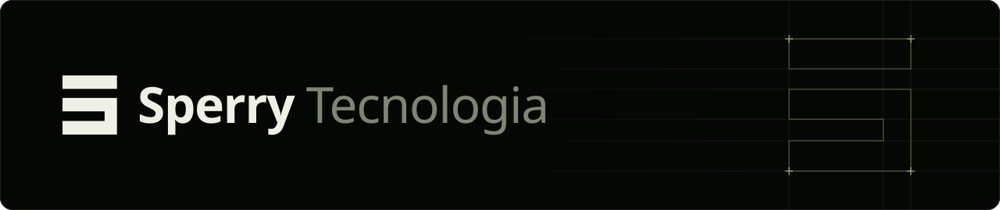

<h1 align="center">
  <picture>
    <source media="(max-width: 640px)" srcset="assets/sperry-hero-compact.svg" />
    
  </picture>
</h1>

  <a href="https://www.sperrytecnologia.com.br"><b>Website</b></a> ·
  <a href="https://debuga.ai"><b>Debuga</b></a> ·
  <a href="https://github.com/SperryTecnologia/debuga-ecosystem"><b>Documentation</b></a> ·
  <a href="https://www.sperrytecnologia.com.br/diagnostico"><b>Contact</b></a>
   
  English · <a href="https://github.com/SperryTecnologia/SperryTecnologia/blob/main/README.pt-BR.md">Português (Brasil)</a>

<h3 align="center">Infrastructure, software and applied AI for operations that cannot stop.</h3>

  Sperry Tecnologia designs, secures and monitors critical infrastructure from Porto Alegre, Brazil. 
  We also build <b>Debuga</b>, a family of applied AI products. None of them is open for purchase yet.

 **[Debuga Voz](https://voz.debuga.ai)** · business phone system on Asterisk, with optional AI call answering 
 extensions, internal calls and two-way audio ·  AI call answering

 **[Debuga Rede](https://debuga.ai/rede)** · AI to diagnose failures and support infrastructure operations 
 early stage, cannot be used yet

 **[Agente Debuga](https://debuga.ai/agente)** · agentic AI to plan, execute and verify engineering tasks 
 technical foundation, no finished feature yet

  Status per feature, architecture and roadmap: <a href="https://github.com/SperryTecnologia/debuga-ecosystem">debuga-ecosystem</a> · Security reports: <a href="https://github.com/SperryTecnologia/debuga-ecosystem/blob/main/SECURITY.md">SECURITY.md</a> · Sales: <a href="https://wa.me/555137374357">WhatsApp</a> · +55 51 3737-4357

