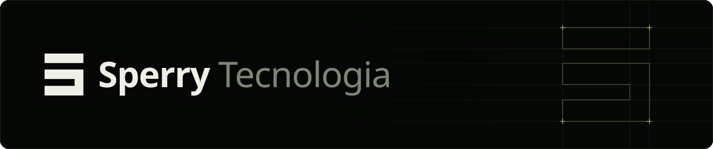

<h1 align="center">
  <picture>
    <source media="(max-width: 640px)" srcset="assets/sperry-hero-compact.svg" />
    
  </picture>
</h1>

  <a href="https://www.sperrytecnologia.com.br"><b>Site</b></a> ·
  <a href="https://debuga.ai"><b>Debuga</b></a> ·
  <a href="https://github.com/SperryTecnologia/debuga-ecosystem/blob/main/README.pt-BR.md"><b>Documentação</b></a> ·
  <a href="https://www.sperrytecnologia.com.br/diagnostico"><b>Contato</b></a>
   
  <a href="https://github.com/SperryTecnologia">English</a> · Português (Brasil)

<h3 align="center">Infraestrutura, software e IA aplicada para operações que não podem parar.</h3>

  A Sperry Tecnologia projeta, protege e monitora infraestrutura crítica a partir de Porto Alegre, Brasil. 
  Também construímos o <b>Debuga</b>, uma família de produtos de IA aplicada. Nenhum está aberto para contratação.

 **[Debuga Voz](https://voz.debuga.ai)** · central telefônica empresarial sobre Asterisk, com atendimento por IA opcional 
 ramais, chamadas internas e áudio nos dois sentidos ·  atendimento com IA

 **[Debuga Rede](https://debuga.ai/rede)** · IA para diagnosticar falhas e apoiar a operação da infraestrutura 
 fase inicial, ainda não pode ser usado

 **[Agente Debuga](https://debuga.ai/agente)** · IA agêntica para planejar, executar e verificar tarefas de engenharia 
 fundação técnica, nenhuma funcionalidade concluída

  Estado por recurso, arquitetura e roadmap: <a href="https://github.com/SperryTecnologia/debuga-ecosystem/blob/main/README.pt-BR.md">debuga-ecosystem</a> · Relato de segurança: <a href="https://github.com/SperryTecnologia/debuga-ecosystem/blob/main/SECURITY.pt-BR.md">SECURITY.pt-BR.md</a> · Comercial: <a href="https://wa.me/555137374357">WhatsApp</a> · +55 51 3737-4357

